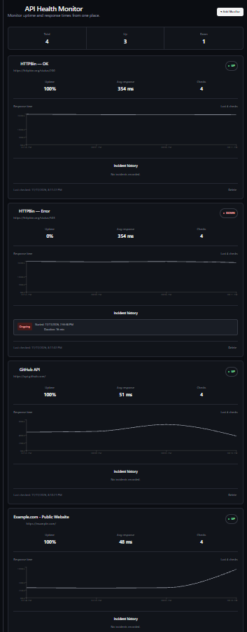
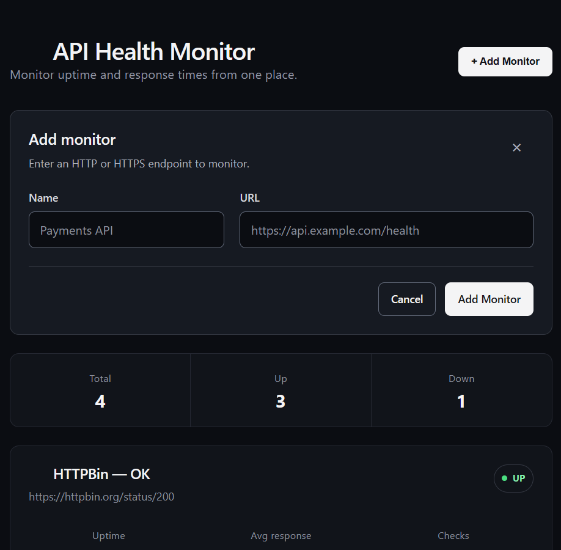
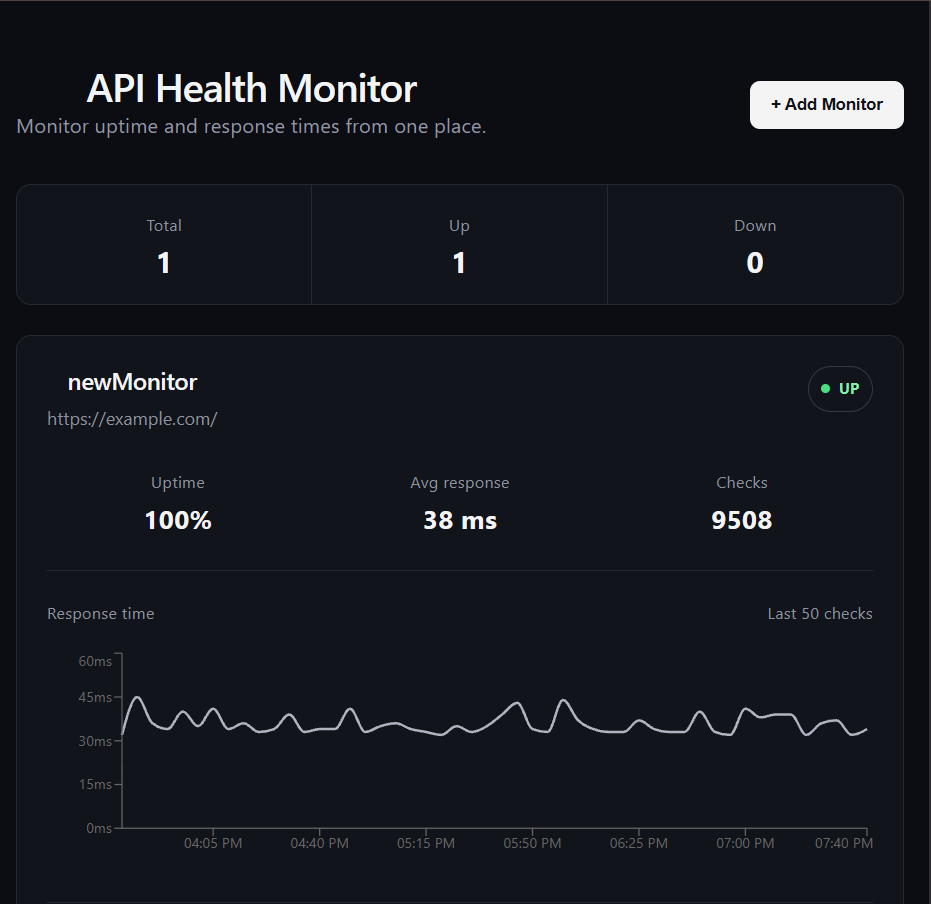
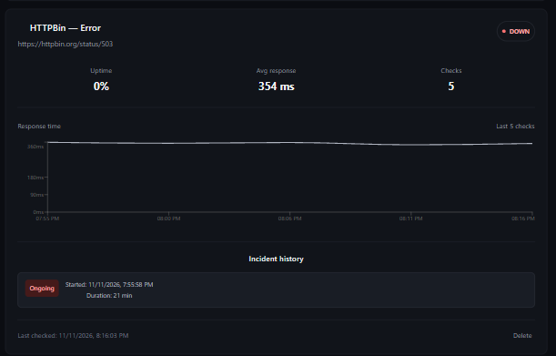

# API Health Monitor

A self-hosted application for tracking HTTP endpoint availability, response times, and incidents. Built as a hands-on backend engineering project with an emphasis on dependable background checks, security when contacting user-supplied URLs, and operational visibility.

## Application screenshots

### Dashboard



### Add a monitor



### Response-time monitoring



### Incident history



*Screenshots from the running application, November 2026. The displayed metrics describe the monitors at capture time, not a general performance or uptime guarantee. The Add Monitor screenshot shows the updated frontend deployed on November 11, 2026.*

The deployed dashboard is protected by HTTP Basic Authentication. Access is intentionally restricted; these screenshots provide a public preview using example and test monitoring targets.

## Features

- Create, list, and delete HTTP(S) monitors.
- Run scheduled endpoint checks in a separate Python worker.
- Show current status, check history, uptime percentage, and average response time.
- Record incidents when a monitor goes down and resolve them when it recovers.
- Optionally send DOWN/RECOVERED email notifications through Resend.
- Expose API, database-readiness, and worker-heartbeat health endpoints.
- Display response-time charts and refresh the dashboard automatically.

## Technology

| Layer | Tools |
| --- | --- |
| Backend | Python 3.13, FastAPI, SQLAlchemy 2, Alembic, httpx |
| Frontend | React 19, TypeScript, Vite, Recharts |
| Data | PostgreSQL 17 |
| Scheduled checks | Separate Python worker |
| Deployment | Docker Compose, Caddy (HTTPS and Basic Auth), nginx frontend container |
| Validation | pytest, GitHub Actions (backend tests/migrations and frontend lint/build) |

These details reflect a repository review at commit `28dfa75` (October 14, 2026). The server checkout was subsequently verified at `664a6d3` on the `security/worker-network-isolation` branch; only the frontend was rebuilt for that update.

## How it works

```text
                 ┌─────────────────────┐
Browser ────────▶│ Caddy + Basic Auth  │
                 └──────────┬──────────┘
                            │
                ┌───────────┴───────────┐
                ▼                       ▼
          React dashboard          FastAPI backend
                                        │
                                        ▼
                                   PostgreSQL
                                        ▲
                                        │
                              Monitoring worker
                                        │
                                        ▼
                            External HTTP(S) URLs
```

The API stores monitor configuration and presents results. A separate worker performs scheduled checks, records outcomes and incidents, and updates its heartbeat. This separates monitoring work from browser requests.

### Selected engineering decisions

- **SSRF defense:** Accept only HTTP(S) monitoring targets, reject non-public addresses, re-resolve and validate DNS at connection time, and revalidate redirects. A check has an overall 10-second deadline.
- **Worker visibility:** Persist worker heartbeats in PostgreSQL and expose a separate worker-health endpoint rather than treating API readiness as proof the worker is functioning.
- **Database evolution:** Use Alembic migrations and apply them as a deliberate deployment step, rather than automatically at container startup.
- **Container hardening:** The reviewed production configuration uses non-root backend/worker containers, dropped capabilities, worker resource limits, and network separation. This is evidence of configuration, not proof that every control is active on the current server.
- **Single-worker constraint:** Monitoring checks are sequential; running multiple workers is not coordinated and can duplicate checks or incidents.

See [`docs/PRODUCTION_READINESS_REPORT.md`](docs/PRODUCTION_READINESS_REPORT.md) and [`docs/WORKER_HEARTBEAT.md`](docs/WORKER_HEARTBEAT.md) for the detailed design and operational risks.

## Run locally

The repository contains `docker-compose.yml`, a production override, and separate `backend/` and `frontend/` projects. Before running it:

1. Review the Compose files and project configuration for the required environment variables. Never commit live `.env` files or credentials.
2. Set up a local PostgreSQL database and apply the migrations in `backend/alembic/`.
3. Start the backend, monitoring worker, and frontend with the repository's documented configuration.
4. Create a monitor pointing to a **public test endpoint you control or are authorized to check**.
5. Confirm that results appear on the dashboard and that the worker health endpoint reports expected status.

**Documentation note:** A complete, verified clean-clone installation procedure and safe `.env.example` still need to be added. Do not treat these high-level steps as a tested quick-start.

## Testing and verification

The repository audit recorded 95 backend test cases and a GitHub Actions pipeline for backend tests/migrations and frontend lint/build. Those results were not rerun for this README. The November 11, 2026 frontend update added a browser regression test for the Add Monitor form. The server checkout was verified at `664a6d3`, the frontend container was rebuilt, and the updated form was observed in the live dashboard. The backend, worker, database, and Caddy containers remained running. This does not establish that every production hardening control is active.

## Known limitations

- Designed for a single operator behind Caddy Basic Auth; the API does not implement its own per-user authentication.
- One worker runs checks sequentially. Multiple workers are not coordinated.
- Worker health is recorded but is not yet connected to external alerting.
- Database backup/restore verification, runtime network restrictions, and some deployment checks remain to be confirmed.
- The dashboard supports adding and deleting monitors, not editing existing entries.
- No frontend unit-test suite was identified in the October 2026 audit.

These limitations are documented intentionally rather than presented as completed features. See the production-readiness report for the current backlog and risk register.

## Project status

A running, authentication-protected dashboard was observed in November 2026. The October 14, 2026 repository audit covered commit `28dfa75`. On November 11, 2026, the server checkout advanced to `664a6d3` and the frontend was redeployed. The updated Add Monitor form was visually verified. This was a frontend-only deployment, not a new verification of every backend or infrastructure control.

This is a personal engineering project. It is not presented as a production service with an uptime SLA.
